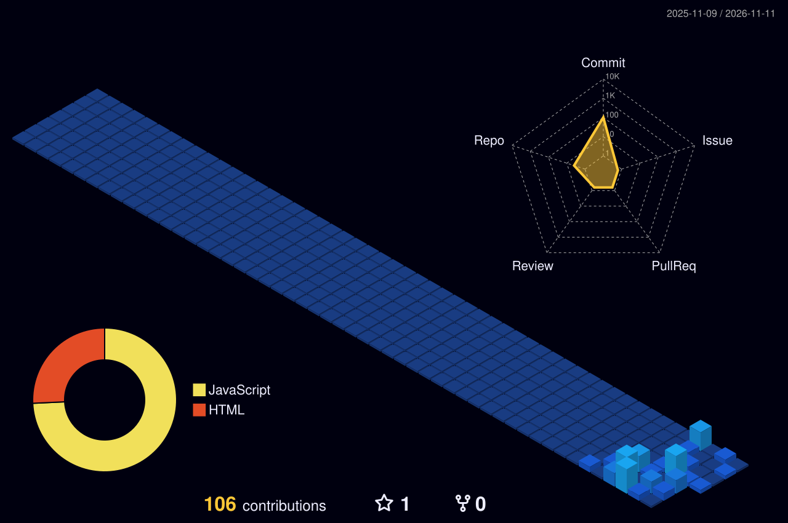

<!-- 1. HERO BANNER -->

  

<!-- 2. WHAT I BUILD & HOBBIES CAROUSEL -->

  

<!-- 3. TECH ORBIT & CHIP GRID -->

  

<!-- 4. HOLOGRAPHIC ID BADGE & LIVE DASHBOARD -->

  

<!-- 5. 3D CONTRIBUTION CITY SKYLINE -->
<picture>
  <source media="(prefers-color-scheme: dark)" srcset="./profile-3d-contrib/profile-night-view.svg" />
  <source media="(prefers-color-scheme: light)" srcset="./profile-3d-contrib/profile-night-view.svg" />
  
</picture>

  

### 🛠️ Featured Flagship Project

| Project | Description | Tech Stack | Status |
| :--- | :--- | :--- | :---: |
| **[SevaSetu](https://github.com/yazantechofficial89/SevaSetu)** | 🤝 **A Digital Bridge Between Care & Need** — Connects donors directly with verified orphanages & old-age homes across India with complete transparency, role-based dashboards, and zero middlemen. | `Node.js` `Express` `MongoDB` `Firebase` `Razorpay` `PWA` | 🌟 Flagship (Live) |

 

  

 

<!-- 6. CONNECT & COLLABORATE FOOTER -->

  

<!-- Direct Interactive Quick Links -->

  
  &nbsp;
  
  &nbsp;
  
  &nbsp;
  

  <!-- GitHub --> <a href="https://github.com/yazantechofficial89" target="_blank"><strong>GitHub Profile</strong></a> &nbsp;•&nbsp;
  <!-- LinkedIn --> <a href="https://www.linkedin.com/in/yazan-gupta-939b46281/" target="_blank"><strong>LinkedIn</strong></a> &nbsp;•&nbsp;
  <!-- Portfolio --> <a href="https://www.yazangupta.online/" target="_blank"><strong>Personal Portfolio</strong></a> &nbsp;•&nbsp;
  <!-- Email --> <a href="mailto:yazangupta39@gmail.com"><strong>Direct Email</strong></a>

 

Crafted with pure SVG + CSS & SMIL animations • Zero external JavaScript dependencies

